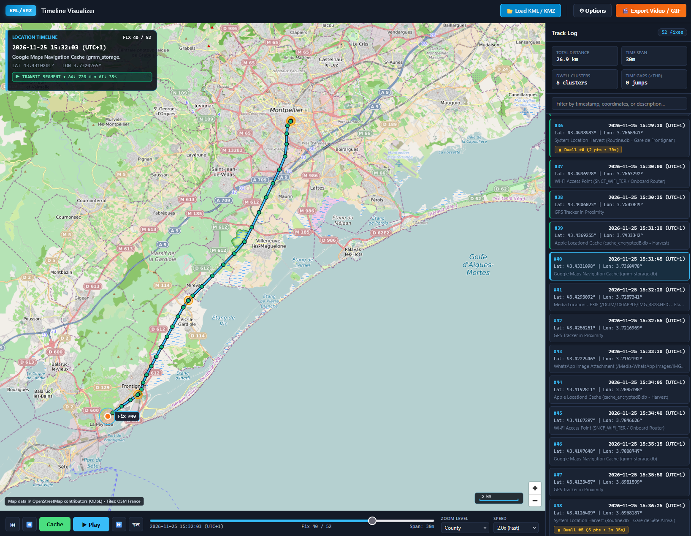
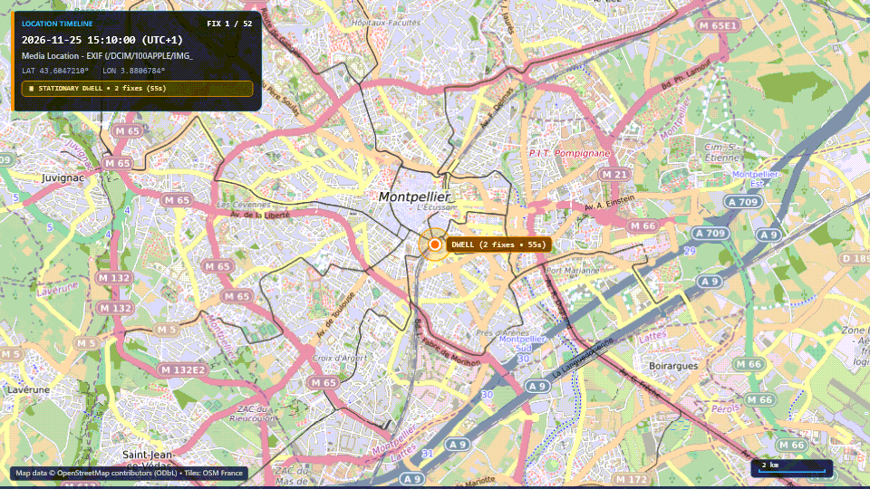

# 📍 KML / KMZ Timeline Visualizer




**KML / KMZ Timeline Visualizer** is a 100% client-side, cross-platform trajectory player and video/GIF exporter designed primarily to play and visualize KML exports from **Cellebrite Physical Analyzer**, but can be used with any KML/KMZ file.

It loads timestamped `.kml` and `.kmz` files locally in the browser—never transmitting coordinates or case metadata to any backend server—and allows you to play back location histories chronologically, compress multi-day inactivity gaps, detect stationary dwell clusters, pre-cache trip maps, and export deterministic **MP4**, **WebM**, and **Animated GIF** clips with a burned-in telemetry HUD.

This tool can be used offline or online.

---

## ✨ Key Features

### 1. KML & KMZ Parsing
- **Native `.kml` & `.kmz` Support:** Drag-and-drop or browse for raw `.kml` XML files or zipped `.kmz` archives (extracted in memory via `JSZip`).
- **Broad Schema Compatibility:** Supports `<Placemark>` nodes with `<TimeStamp><when>`, `<TimeSpan><begin>`, Google Earth `<gx:Track>`, and Cellebrite Physical Analyzer `<name>` / `<description>` timestamp formats.
- **Timezone Preservation:** Extracts and preserves the original UTC offset recorded in the evidence file (e.g., `UTC+2` from `2026-06-30T16:45:00+02:00`) so timestamps never silently shift to the examiner's local machine timezone, with a one-click option to toggle to `UTC (Z)`.

### 2. Three Playback Timing Modes
Location histories often span weeks with multi-day idle gaps alongside 10-minute bursts of movement. Choose the timing mode that fits your dataset:
- **Smart Gap-Compression *(Default)*:** Plays active local and regional movement proportionally while automatically fast-forwarding inactivity periods exceeding your configurable **Gap Threshold** (`30m`, `1h`, `4h`, `12h`, `24h`) with a visual `⏩ TIME GAP JUMP` indicator.
- **Point-to-Point Sequential:** Allocates uniform duration to every transition (`Fix #1 → #2 → #3`), ideal for stepping through sparse fixes regardless of time delta.
- **Strict Linear Clock:** Advances the timeline clock at a constant real-time rate from first fix to last fix, ideal for continuous single-trip recordings (e.g., a continuous drive or flight).

### 3. Stationary Dwell Detection & `0m` Drone Mode
- **Dwell Clustering (`15m` – `150m`):** Automatically groups consecutive fixes within a configurable proximity radius into **Stationary Dwell Clusters**, displaying a pulsing amber dwell ring, fix count, and total dwell duration (`⏸ DWELL • 10 fixes • 8h 55m`).
- **Drone & Micro-Track Mode (`0 Meters`):** Setting the dwell radius to **`0 Meters`** disables grouping so every single closely spaced GPS waypoint (such as a hovering or grid-flying drone) is rendered and animated individually.

### 4. Preloaded Offline Map + Global High-Precision Maps
Switch between three purpose-built base maps in **⚙ Options**:
1. **⚡ Offline Map (Regional Vector) *(Default)*:** A built-in, preloaded global vector map (**242 countries & coastlines, 412 lakes, 10° graticule grid, and 2,438 cities**) bundled directly in memory so the tool works on **100% air-gapped workstations with zero internet connection**.
2. **🗺 OpenStreetMap (Online: Streets & Buildings):** Global street, building-footprint, intersection, and street precision down to **Zoom 19** across all countries worldwide.
3. **🛰 ArcGIS World Imagery (Online: Aerial Terrain):** High-resolution global satellite and aerial imagery with hybrid place labels up to **Zoom 18**.

### 5. One-Click Trip Map Pre-Caching (`Cache` Button)
- Click the light-green **`Cache`** button next to **`▶ Play`** before playback to pre-load all street or satellite tiles along the entire journey into RAM (`0% → 100% → ✔ Cached`).
- Eliminates map loading lag during fast playback or across long-distance international jumps.

### 6. Quick Zoom Presets & Camera Framing
- **One-Click Zoom Level Selector:** Instantly switch between **Drone / Exact** (`Zoom 18.2`), **Street (Precise)** (`Zoom 16.5`), **City** (`Zoom 12`), **County** (`Zoom 9`), **Region** (`Zoom 6.5`), and **Country** (`Zoom 4.5`), or zoom freely with the mouse wheel at any time.
- **Steady Camera Modes:** **Follow Active Fix** (locks onto the moving coordinate at your chosen zoom level without disorienting zoom bouncing), **Global Overview** (frames the entire trajectory), or **Free Camera**.

### 7. Video (`MP4` / `WebM`) & `GIF` Export
- **Two-Phase Zero-Lag Renderer:** Pre-caches all visible map tiles along the journey before encoding Frame 0, then composites the map, progressive trajectory line, dwell indicators, metric scale bar, attribution badge, and top-left **Telemetry HUD Card** frame-by-frame into:
  - **MP4 Video (H.264 / WebCodecs)** at `720p HD` or `1080p Full HD`
  - **WebM Video (VP9)**
  - **Animated GIF** (via a built-in zero-dependency GIF89a LZW encoder that works offline without Web Worker CORS blocks)



---

## 🚀 Quick Start

### Option A: Single-File Portable file*
For maximum portability across Windows, macOS, and Linux (including locked-down workstations):
1. Copy the single self-contained file **[dist/kmz-visualizer.html](dist/kmz-visualizer.html)** to any machine.
2. Double-click **`kmz-visualizer.html`** to open it in any modern browser.
3. Click **📂 Load KML / KMZ** (or drag and drop a file onto the map).

### Option B: Run from Modular Source
Open **[index.html](index.html)** directly in your browser, or serve the folder over a local HTTP server:
```bash
npx serve -l 8080
```

---

## 🗂 Project Structure

```text
kmz_visualize/
├── dist/
│   └── kmz-visualizer.html    # Single-file 100% self-contained portable app (~3.4 MB)
├── js/
│   ├── app.js                 # Main UI controller, transport deck, options & event wiring
│   ├── kmlParser.js           # KML/KMZ parser, timezone offset extractor & dwell analyzer
│   ├── timelineEngine.js      # Smart Gap-Compression, Sequential & Linear timeline scheduler
│   ├── mapController.js       # MapLibre GL base map controller (Offline Vector, OSM & Satellite)
│   ├── hudRenderer.js         # 60-FPS 2D canvas renderer for trajectory, HUD card & scale bar
│   ├── exporter.js            # Deterministic Web Mercator tile pre-cacher & MP4/WebM/GIF encoder
│   └── localWorldMap.js       # Preloaded offline Natural Earth vector world map bundle
├── vendor/                    # Locally cached frontend libraries for offline standalone builds
│   ├── maplibre-gl.js
│   ├── maplibre-gl.css
│   ├── jszip.min.js
│   └── mp4-muxer.js
├── media/                     # Screenshots & exported journey demonstrations
│   ├── kmz_visualize.png
│   └── journey-2026-11-26-09-50-54.gif
├── index.html                 # Modular application entry point
├── styles.css                 # Dark-mode UI stylesheet
├── build-standalone.js        # Node.js bundler that compiles everything into dist/kmz-visualizer.html
├── build_standalone.bat       # Windows one-click launcher for build-standalone.js
├── update-local-map.js        # Script to refresh js/localWorldMap.js from Natural Earth
├── update_local_map.bat       # Windows one-click launcher for update-local-map.js
├── LICENSE                    # Software licence & legal notice
└── README.md                  # Project documentation
```

---

## 🛠 Rebuilding & Updating

If you modify any source file in `js/`, `index.html`, or `styles.css`:
- **Rebuild the Single-File Bundle:** Double-click **`build_standalone.bat`** or run:
  ```bash
  node build-standalone.js
  ```
  This regenerates `dist/kmz-visualizer.html` completely offline using the cached libraries in `vendor/`.
- **Refresh the Preloaded Offline World Map:** While connected to the internet, double-click **`update_local_map.bat`** or run:
  ```bash
  node update-local-map.js
  ```

---

## ⌨️ Keyboard Shortcuts

| Key | Action |
| :--- | :--- |
| **`Space`** | Play / Pause timeline playback |
| **`Right Arrow`** | Step forward to the next waypoint fix (`⏩`) |
| **`Left Arrow`** | Step backward to the previous waypoint fix (`⏪`) |
| **`Mouse Wheel / Drag`** | Freely zoom in/out (up to Zoom 19) or pan the map at any time |

---

## 📜 Licence & Legal Notice

**Created by Bruno Bordas** — *Copyright © Bruno Bordas. All Rights Reserved.*

1. **Ownership & Prohibition of Unauthorized Modification:**
   This software application (**KML / KMZ Timeline Visualizer**), including its source code, user interface, algorithms, and bundled documentation, is the proprietary work of **Bruno Bordas**.
2. **Disclaimer of Warranty & Refusal of Liability:**
   This software is provided strictly **"AS IS"**, without warranty of any kind, express or implied. In no event shall **Bruno Bordas** be held liable or responsible for any claim, damages, data loss, interpretation errors, or any other direct, indirect, incidental, or consequential issues arising out of or in connection with the use or performance of this software. Users assume full responsibility for verifying any output against original data.
3. **Map Data Attribution:**
   - Online street map tiles and data: **© OpenStreetMap contributors** under the Open Database License (ODbL), rendered via **OpenStreetMap France**.
   - Satellite imagery: **© Esri World Imagery**.
   - Offline vector map data: Public-domain **Natural Earth** datasets.
